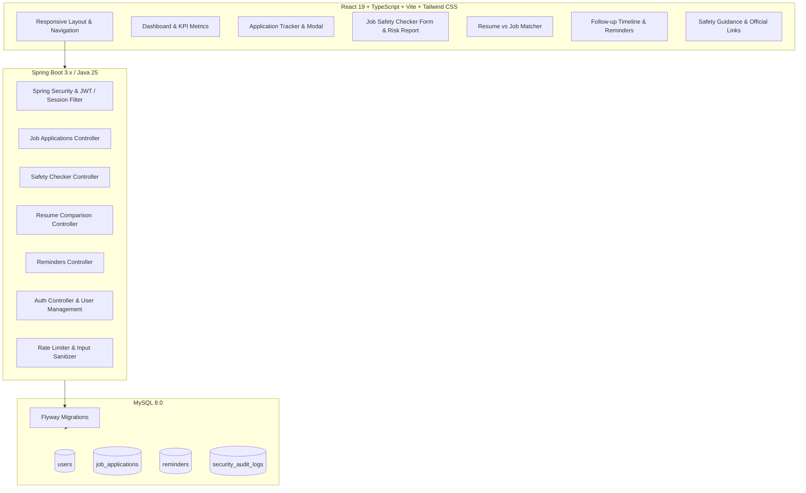

# OpportunityShield — Architecture & Implementation Plan

## Executive Summary
**OpportunityShield** is a full-stack, security-conscious web application designed to empower job seekers against fraudulent employment offers, recruiter impersonation, phishing, and application chaos. It integrates:
1. **Interactive Dashboard**: High-level overview of metrics, upcoming interviews, deadlines, and real-time safety advisories.
2. **Job Application Tracker**: Full lifecycle management of job applications (Saved, Applied, Assessment, Interview, Offer, Rejected, Withdrawn) with strict data boundaries.
3. **Rule-Based Job Safety Checker**: Automated, transparent heuristic scanner for upfront payment demands, suspicious contacts (free email domains, telegram/whatsapp interview requests), impersonation signals, and unrealistic compensation vs. requirements.
4. **Transparent Resume-to-Job Comparator**: Privacy-first client/server skill matcher that reveals exact matches, missing keywords, and contextual suggestions without retaining resume data or fabricating qualifications.
5. **Follow-up & Interview Reminders**: In-app timeline and calendar alerts for critical milestones.
6. **Safety & Verification Education Center**: Fact-checked guidance on safe job-search practices with official reporting resources (FTC, IC3, Better Business Bureau).

---

## 1. System Architecture

---

## 2. Security Architecture & Threat Mitigations

| Threat | Mitigation Strategy |
| :--- | :--- |
| **SSRF (Server-Side Request Forgery)** | Pasted text analysis is standard. Any URL retrieval parses IP addresses, strictly disallows loopback (`127.0.0.1`), link-local (`169.254.0.0/16`), private subnets (`10.0.0.0/8`, `172.16.0.0/12`, `192.168.0.0/16`), cloud metadata endpoints, IPv6 link-local, non-HTTP/HTTPS protocols, and unsafe redirects. |
| **Prompt Injection / Untrusted Input** | User inputs (pasted recruiter messages, emails, resumes) are strictly treated as untrusted text strings evaluated via deterministic regex & keyword heuristics, never fed into unconstrained command or prompt loops. |
| **Data Retention & Privacy** | Resumes and pasted job offers are analyzed in-memory and NOT stored to disk or database unless the user explicitly saves a structured application entry. |
| **XSS & Content Injection** | React automatic escaping, strict Content-Security-Policy headers, and sanitized rich content rendering. |
| **Broken Object Level Authorization (BOLA)** | Every database query scopes `userId` from the authenticated security context (`WHERE id = :appId AND user_id = :userId`). |
| **Rate Limiting & Abuse** | Bucket4j or token bucket rate limiter on safety evaluation and authentication endpoints. |

---

## 3. Technology Stack & Compatibility Matrix

- **Frontend**:
  - React 19.x with TypeScript 5.8+ / 6.x
  - Vite 6.x / 8.x
  - Tailwind CSS + Lucide React for consistent icons
  - Vitest + React Testing Library for frontend component tests
- **Backend (Phase 2+)**:
  - Java 25 LTS / 21 LTS compatible Spring Boot 3.4.x
  - Spring Security with BCrypt password hashing & JWT / session tokens
  - Spring Data JPA + Hibernate with Parameterized queries
  - Flyway for reproducible database schema migrations
  - Springdoc OpenAPI (Swagger UI) for interactive documentation
  - Testcontainers / H2 for backend integration and API tests
- **Database**:
  - MySQL Server 8.0 (verified present on local host)

---

## 4. Phase Breakdown & Deliverable Tracking

- **Phase 1 (Completed)**:
  - Inspect environment and tools.
  - Document system architecture and specifications (`ARCHITECTURE_PLAN.md`).
  - Implement full frontend shell with responsive dashboard, sample data indicators, job application manager, rule-based safety analyzer, resume keyword comparator, follow-up scheduler, and education center.
  - Add unit tests for frontend components and verify test pass (14/14 Vitest tests passing).
  - Verify build & run locally on Vite dev server (`http://127.0.0.1:5173/`).
- **Phase 2 (Completed)**:
  - Set up Spring Boot 3.4.3 project with Maven 3.9.9 and Java 25 LTS compatibility in `backend/`.
  - Configure database connection (H2 MySQL-compatibility mode default and production `application-mysql.yml`) and Flyway schema migrations (`V1__init_schema.sql`).
  - Implement Applications CRUD REST endpoints with DTO validation, user scoping, and GlobalExceptionHandler.
  - Connect React frontend to Spring Boot API via `apiService` in `frontend/src/services/api.ts`.
- **Phase 3 (Completed)**:
  - Authentication (Registration, Login, JWT tokens with BCrypt password hashing).
  - Multi-user isolation verified (BOLA protection tested via `JobApplicationAccessControlTest` and live API verification).
  - Front-end AuthModal with 1-click test user switcher between Candidate 1 (`candidate1@opportunityshield.org`) and Candidate 2 (`candidate2@opportunityshield.org`).
- **Phase 4 (Completed)**:
  - Rule-based safety checker engine in Spring Boot (`SafetyCheckerService`) with comprehensive unit tests (`SafetyCheckerServiceTest`).
  - Transparent scoring, risk factors (check fraud, equipment scam, fee demands, suspicious free domains, messaging app interviews), and safety limitations.
- **Phase 5 (Completed)**:
  - Resume-to-job keyword and skill gap comparison engine (`ResumeComparisonService`) with zero-persistence privacy guarantees.
  - In-app reminder scheduler & notifications dashboard (`ReminderService`, `ReminderController`) with auto-scheduling on interview/follow-up dates.
- **Phase 6 (Completed)**:
  - End-to-end integration testing, security audit, CORS and rate limit hardening, production build validation.
  - 10/10 backend tests passing (`mvn test`), 14/14 frontend tests passing (`npm test`), production build clean (`npm run build`).
  - OpenAPI/Swagger UI live and interactive at `http://localhost:8081/swagger-ui.html`.
