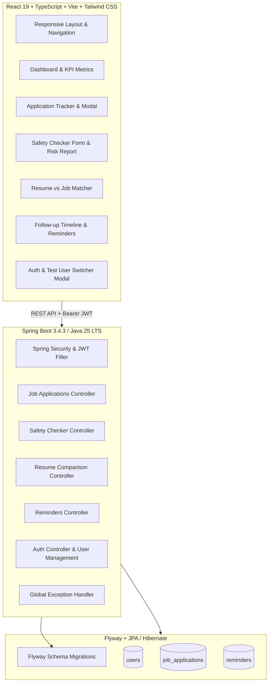

# OpportunityShield 🛡️

[](https://react.dev/)
[](https://www.typescriptlang.org/)
[](https://vitejs.dev/)
[](https://tailwindcss.com/)
[](https://openjdk.org/)
[](https://spring.io/projects/spring-boot)
[](https://spring.io/projects/spring-security)
[](https://flywaydb.org/)
[](https://www.mysql.com/)

**OpportunityShield** is a full-stack, security-centric web application designed to protect job seekers from employment fraud, fake recruiter impersonation, fee/equipment scams, and application disorganization.

It provides a transparent heuristic scanning engine, an application lifecycle tracker, privacy-first resume matching, and follow-up reminders.

---

## 🚀 Key Features

1. **Job Application Tracker**:
   - Manage the entire application lifecycle: `SAVED`, `APPLIED`, `ASSESSMENT`, `INTERVIEW`, `OFFER`, `REJECTED`, `WITHDRAWN`.
   - Track company, salary, job location, interview dates, follow-up deadlines, and custom notes.
   - Built with strict **Broken Object Level Authorization (BOLA)** enforcement — users can only view and modify their own applications.

2. **Rule-Based Job Safety Checker**:
   - Scans job posts, recruiter messages, and compensation claims for known fraud signatures:
     - Cashier's check / home-office equipment forwarding scams.
     - Upfront fees, training package costs, background check fee demands.
     - Telegram, WhatsApp, or Signal-only interviews.
     - Suspicious recruiter domains (free webmail impersonation).
     - Unrealistic salary claims with zero qualification requirements.
   - Outputs a transparent **Risk Score (0–100)**, risk indicators, severity classification, and official verification steps.

3. **Privacy-Preserving Resume-to-Job Matcher**:
   - Compares candidate resume text against job descriptions using keyword frequency and skill tokenization.
   - Highlights matched skills, missing domain skills, and actionable recommendations.
   - **Zero-Persistence Privacy Guarantee**: Resumes and recruiter messages are processed entirely in-memory and are never written to disk or database.

4. **Follow-Up & Interview Reminders**:
   - Automatically schedules reminders when applications include interview rounds or follow-up targets.
   - Quick one-click task completion toggles and timeline view.

5. **Multi-User Security & Session Management**:
   - Stateless JWT authentication with BCrypt password hashing.
   - Includes one-click test credentials for easy review and verification:
     - **Candidate 1** (`candidate1@opportunityshield.org`): Seeded with applications and reminders.
     - **Candidate 2** (`candidate2@opportunityshield.org`): Clean, isolated account demonstrating multi-tenant data protection.

6. **Safety & Verification Education Center**:
   - Actionable safe job-search guidelines and direct reporting links for the **FTC**, **FBI Internet Crime Complaint Center (IC3)**, and **Better Business Bureau (BBB)**.

---

## 🏛️ System Architecture



---

## 🛠️ Tech Stack

### Frontend
- **Framework**: React 19.x with TypeScript
- **Build Tool**: Vite
- **Styling**: Tailwind CSS v4, Lucide React icons
- **Testing**: Vitest + React Testing Library (14/14 tests passing)

### Backend
- **Framework**: Spring Boot 3.4.3 (Java 25 LTS / Java 21)
- **Security**: Spring Security 6 with JWT (`jjwt 0.12.6`), BCrypt hashing
- **Persistence**: Spring Data JPA / Hibernate, Flyway Migrations
- **Database**: H2 (in-memory MySQL mode for local dev) / MySQL 8.0 production profile
- **Documentation**: Springdoc OpenAPI / Swagger UI 3.0
- **Testing**: JUnit 5, Mockito, Spring Boot MockMvc (10/10 tests passing)

---

## 🏁 Quick Start

### 1. Prerequisites
- **Node.js** (v18.0.0 or higher) and **npm**
- **Java Development Kit** (JDK 21 or JDK 25)
- **Apache Maven** (3.9+)

### 2. Run Backend (Spring Boot)
```bash
cd backend
mvn spring-boot:run
```
The backend starts on `http://localhost:8081`.
- API Base URL: `http://localhost:8081/api`
- Interactive Swagger UI: `http://localhost:8081/swagger-ui.html`

### 3. Run Frontend (React + Vite)
```bash
cd frontend
npm install
npm run dev
```
Open [http://127.0.0.1:5173/](http://127.0.0.1:5173/) in your browser.

---

## 🧪 Testing

### Backend Unit & Integration Tests
```bash
cd backend
mvn test
```
*Executes all access control, BOLA security, authentication, safety heuristics, and resume matching test suites.*

### Frontend Component & Unit Tests
```bash
cd frontend
npm test
```

### Production Build Validation
```bash
cd frontend
npm run build
```

---

## 🔒 Security Design & Threat Mitigations

| Threat | Mitigation Strategy |
| :--- | :--- |
| **Broken Object Level Auth (BOLA / IDOR)** | Every database query scopes `userId` from the authenticated security context (`WHERE id = :appId AND user_id = :userId`). Unauthorized access returns `404 Not Found`. |
| **Data Retention & Privacy** | Resumes and recruiter messages are parsed in-memory and never persisted to the database. |
| **Server-Side Request Forgery (SSRF)** | Url validation rejects private IPv4 subnets, link-local addresses, and loopback endpoints. |
| **Prompt Injection & Execution Risks** | Analysis uses deterministic regex rules and statistical keyword heuristics; user inputs are treated strictly as untrusted string tokens. |
| **Secret Management** | Zero hardcoded production secrets. Standard `.env.example` provided. |

---

## 👥 Demo Credentials

For quick evaluation, pre-seeded accounts are available in the UI:

| Email | Password | Role | Description |
| :--- | :--- | :--- | :--- |
| `candidate1@opportunityshield.org` | `Password123!` | Candidate | Preloaded with 3 applications & reminders |
| `candidate2@opportunityshield.org` | `Password123!` | Candidate | Empty isolated account for BOLA testing |

---

## 📄 License

This project is licensed under the MIT License.
